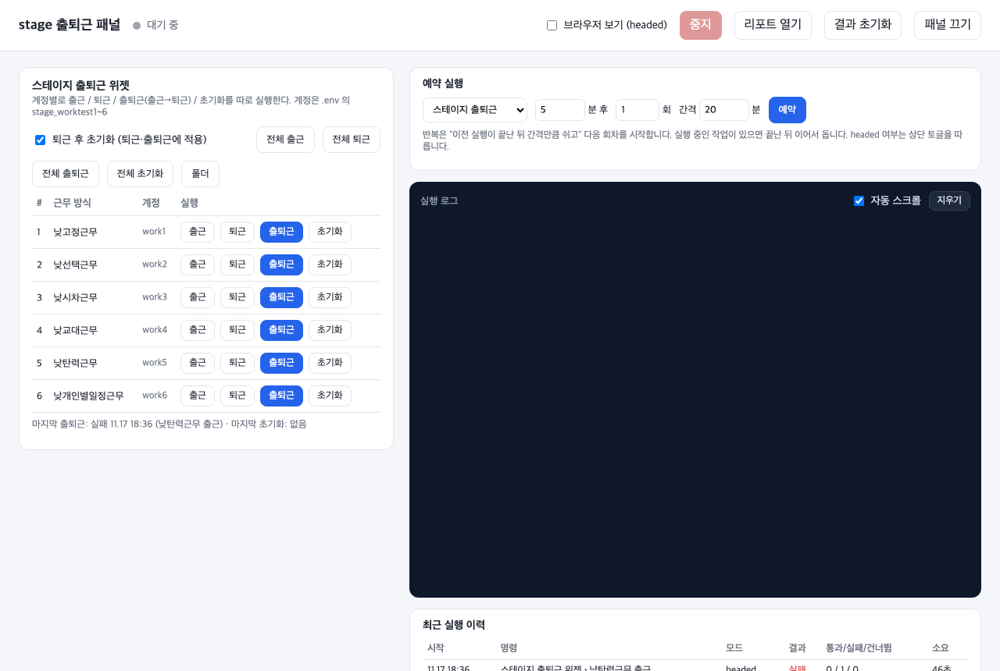

# stage 출퇴근 위젯 자동 점검

네이버웍스 stage 환경(stage-home.worksmobile.com)에서 근무 유형별 계정 6개가 출근·퇴근을 정상으로 할 수 있는지 Playwright로 확인합니다. 버튼으로 돌릴 수 있는 실행 패널이 함께 들어 있습니다.

## 파일

| 파일 | 역할 |
| --- | --- |
| `stage_att.spec.js` | 낮 근무 계정 6개(work1~6) 출근 후 퇴근. 옵션으로 출근만 / 퇴근만, 퇴근 뒤 초기화까지. |
| `stage_att_reset.spec.js` | 위 계정 6개의 출퇴근 기록만 초기화. |
| `runner-ui/` | 계정별 출근 / 퇴근 / 출퇴근 / 초기화 버튼이 있는 로컬 실행 패널. |

계정 순서는 1 고정 · 2 선택 · 3 시차 · 4 교대 · 5 탄력 · 6 개인별일정근무이며, 아이디와 비밀번호는 `.env`에서 읽습니다.

## 사전 설정: 출퇴근 허용 IP 등록

테스트를 돌리는 PC의 공인 IP가 각 계정의 근무 방식에 허용 IP로 등록되어 있어야 합니다. 등록되지 않으면 "현재 IP 주소에서는 출퇴근을 체크할 수 없습니다." 토스트와 함께 해당 계정은 건너뛰어집니다.

1. 관리자 계정으로 stage 관리자 서비스에 들어가 **근태 > 근무 > 근무 방식 관리**를 엽니다.
2. 테스트 계정이 쓰는 근무 방식(고정·선택·시차·교대·탄력·개인별일정)마다 **수정**을 누릅니다.
3. 출퇴근 체크 IP 설정에서 **본인 PC의 IP를 직접 입력**하고 저장합니다.
4. 네트워크(사무실, 재택, VPN)가 바뀌면 공인 IP도 바뀌므로 다시 등록해야 합니다.

## 준비

```bash
npm install
npx playwright install chromium
cp .env.example .env   # 계정 아이디/비밀번호 값을 채웁니다
```

- 테스트 PC의 공인 IP가 계정의 출퇴근 허용 IP에 포함되어야 합니다. 아니면 "현재 IP 주소에서는 출퇴근을 체크할 수 없습니다." 토스트로 건너뜁니다.
- 낮 근무 계정이므로 근무 시간대(09시~18시) 안에 실행하세요. 근로 시간이 끝난 계정은 "근로 시간이 종료되었습니다"로 출근하지 않고 건너뜁니다.

## 실행 패널

```bash
npm run ui             # 서버를 켜고 브라우저에 패널을 엽니다 (http://127.0.0.1:4174)
```

Finder에서 `runner-ui/start.command`를 더블클릭해도 됩니다. 포트 4174가 쓰이고 있으면 자동으로 다음 포트에서 켜지고 터미널에 주소가 찍힙니다.



- 줄마다 **출근**(출근만) · **퇴근**(퇴근만) · **출퇴근**(출근→퇴근) · **초기화** 버튼이 있고, 위의 **전체** 버튼은 여섯 계정을 순서대로 돕니다.
- **퇴근 후 초기화** 체크(기본 켬)가 켜져 있으면 퇴근·출퇴근을 마친 계정을 바로 초기화해 다음 실행을 위해 되돌립니다. 출근만 할 때는 적용하지 않습니다.
- **브라우저 보기(headed)** 토글을 켜면 브라우저 창을 띄워 실행합니다.
- 오른쪽에 실행 로그가 실시간으로 흐르고, 아래 표에 최근 실행 이력(결과·소요 시간)이 남습니다. **중지**는 실행 중인 테스트와 브라우저를 끕니다.
- **예약 실행**: 명령을 고르고 "N분 후", 필요하면 "N회 / 간격 N분"을 정해 예약하면 시간이 되면 자동으로 돕니다.
- **폴더**는 출퇴근 확인 캡처 폴더(`results/`)를 엽니다. **패널 끄기**는 Playwright 산출물과 실행 이력만 지우고 캡처는 남깁니다.
- 한 번에 하나만 실행됩니다. 실행 중에 다른 버튼을 누르면 안내만 뜹니다.

## 명령으로 실행

```bash
npm run att             # 여섯 계정 출근 → 퇴근
npm run att:headed      # 브라우저 창을 보면서
npm run reset           # 여섯 계정 초기화
npm run reset:headed
```

일부 계정만, 또는 모드를 바꿔서:

```bash
STAGE_ATT_ACCOUNTS=1,5 npm run att                       # 1번(고정)·5번(탄력)만
STAGE_ATT_MODE=in npm run att                            # 출근만
STAGE_ATT_MODE=out STAGE_ATT_RESET_AFTER=1 npm run att   # 퇴근만 하고 바로 초기화
STAGE_ATT_ACCOUNTS=고정 npm run reset                    # 이름 일부로도 지정 가능
```

| 환경변수 | 값 | 뜻 |
| --- | --- | --- |
| `STAGE_ATT_ACCOUNTS` | `1,3` / `고정,탄력` / `work1` | 돌릴 계정 (번호, 이름 일부, 아이디 앞부분). 없으면 전부 |
| `STAGE_ATT_MODE` | `in` / `out` / `both` | 출근만 / 퇴근만 / 출근 후 퇴근 (기본 both) |
| `STAGE_ATT_RESET_AFTER` | `1` | 퇴근을 마친 계정을 바로 초기화 (출근만 모드에는 적용 안 함) |

패널의 버튼은 이 환경변수를 붙여 같은 명령을 실행하는 것입니다.

## 진행 순서

1. 결과 폴더(`results/`)를 비웁니다.
2. 계정 6개를 순서대로 로그인해 출근합니다. 이미 ON이거나 출근 버튼이 없으면 상세 팝업에서 초기화한 뒤 출근합니다. 근무 일정이 없거나 근로 시간이 끝난 계정은 건너뜁니다.
3. 출근한 계정을 다시 순서대로 로그인해 퇴근합니다. 퇴근만 모드에서는 출근 상태가 아닌 계정을 건너뜁니다.
4. 퇴근이 확인되면 홈 화면 전체를 `라벨 출퇴근확인.png`로 저장합니다. 화면 상단에 라벨/계정/시각 띠가 들어갑니다.
5. `STAGE_ATT_RESET_AFTER=1`이면 퇴근을 마친 계정을 바로 초기화합니다.
6. 퇴근 실패나 예외가 하나라도 있으면 테스트가 실패로 끝납니다. 출근 단계에서 건너뛴 계정은 실패로 집계되지 않으므로 결과 폴더의 확인 파일 수도 함께 보세요. 단, 선택한 계정이 모두 건너뛰어져 처리 0건이면 실패로 끝나며, 메시지에 계정별 건너뛴 사유가 함께 적힙니다.

## 부정 토스트(빨간 오류 토스트) 처리

| 토스트 | 대응 | 스크린샷 |
| --- | --- | --- |
| 출근과 퇴근에 같은 시간을 입력할 수 없습니다. | 20초 후 재시도, 최대 3회 | 1·2회차 생략, 3회차에 저장 |
| 근로 시간을 선택하세요. | 근로 시간 라디오 선택 후 1회 재시도 | 재시도 실패 시 저장 |
| 현재 IP 주소에서는 출퇴근을 체크할 수 없습니다. | 해당 계정 건너뜀(퇴근도 제외) | 즉시 저장 |
| 그 밖의 빨간 토스트 | 로그에 남기고 건너뜀. 퇴근 단계면 실패로 기록 | 즉시 저장 |

스크린샷 이름은 `라벨 부정 토스트 확인.png`이며 같은 계정에서 여러 장이면 `확인1`, `확인2`처럼 번호가 붙습니다. 성공(파란) 토스트는 찍지 않습니다.

## 알아둘 점

- 실제 데이터가 바뀝니다. 출퇴근 초기화·출근·퇴근이 stage 계정에 실제로 수행됩니다. 테스트 계정에서만 사용하세요.
- 위젯 버튼 문구가 관리자 설정에 따라 달라도(출근/ON/IN/시작, 퇴근/OFF/OUT/종료, 휴게/PAUSE) 동작합니다. 버튼은 고정 속성으로 찾고 문구는 보조로만 씁니다.
- 탄력근무는 출근만 기록하는 유형이라 퇴근 버튼이 없어도 정상 출근으로 처리합니다.
- 계정 아이디와 비밀번호는 `.env`에만 두고 저장소에는 올리지 않습니다. 변수 이름은 `.env.example`을 참고하세요.
- 실패 캡처와 HTML 리포트는 `.playwright/` 아래에 생기며 git에 올라가지 않습니다. 패널의 "리포트 열기"로 볼 수 있습니다.
